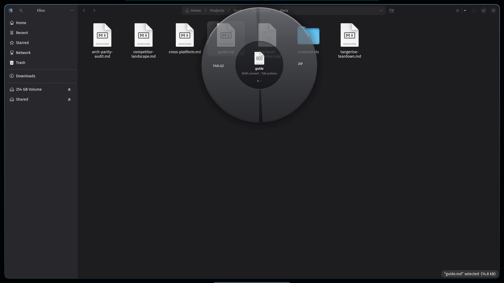

# Mandarine

New here? Start with the [hands-on tutorial](TUTORIAL.md) — install, first conversion, and the four ways to open the wheel.

A **Tangerine-style drag-and-drop file converter for Linux and Windows**, in Rust + GTK4.



*Drop a file, pick a sector, and the result lands beside the original.*

First-class on Hyprland/Wayland (layer-shell wheel + edge strip); portable GTK4 toplevel on
X11 and Windows with native clipboard, hotkey and theme adapters. See
[`docs/cross-platform.md`](docs/cross-platform.md).
Press a hotkey, a radial wheel appears under the cursor, drop file(s) on it, pick a sector, and
the converted file lands next to the original. Everything runs locally through engines you
already have (`ffmpeg`, ImageMagick, poppler, LibreOffice, zip/7z/unrar) — nothing is uploaded.

There is no Linux equivalent of [Tangerine](https://tangerineformac.com/); this is it.
See [`docs/tangerine-teardown.md`](docs/tangerine-teardown.md) for the reverse-engineered
feature matrix the target registry is built from. The wider survey of similar tools
(DotMorph, twistel, Kumquat, Morph and others) and what was folded in from it is in
[`docs/competitor-landscape.md`](docs/competitor-landscape.md).

## Usage

| Key | Page |
|---|---|
| **SUPER+Y** | open the wheel under the cursor |
| **Shift** (or nothing) | conversions — the wheel's default page |
| **Ctrl** | file actions: Copy, Copy Path, Terminal, Compress, Extract |
| **Alt** | editing tools: Strip Meta, Rotate 90, Resize 50, Mute, Normalize |
| **Tab** | cycle the three pages |
| **1–9** / click / **←→** + **Enter** / **scroll** | pick a sector (**Enter** fires only a sector that is lit) |
| **ESC** | cancel |

`SUPER+Y` again while the wheel is open closes it — one instance, not two stacked dials.

**Mid-drag:** start dragging in your file manager, then tap `SUPER+Y` without releasing the
button. The dial opens under the pointer, hops it 1 px so Hyprland hands the *in-flight* drag
to the new window, and waits: release over a sector.

**No hotkey at all — drag to the edge.** Wayland has no global "a drag started" event: a client
only learns about a drag by already owning a surface it can be offered to. `mandarine listen`
therefore stays resident with one 6 px drop target hugging a screen edge. A drag that touches it
opens the dial under the cursor; leaving or cancelling without dropping fades it back out.

```sh
mandarine listen --edge top        # also: bottom, left, right
# once per session, e.g. in ~/.config/hypr/hyprland.conf
exec-once = mandarine listen --edge top
```

Standby costs one mapped surface and nothing else — no timers, no animation, no redraws.
Measured on a release build here: 0 CPU ticks over six seconds, ~33 MB PSS (RSS reads much
larger because GTK's shared libraries are counted per process). Choose the edge your bars and
docks leave free: the strip takes pointer input across its 6 px, so an edge you click a lot is
the wrong one.

The dial itself is a **layer-shell OVERLAY surface**, not a window: it sits above every window
except the standby strip, never enters the tiling or focus machinery, needs no float/decorate
rules, and is placed by anchors plus margins (top-left anchor, offsets from the output's origin)
rather than by `hyprctl`. Same surface type as the strip, and the same reason it can receive a
drag: as of Hyprland 0.56 the compositor hit-tests the OVERLAY and TOP layers during a drag —
`mouseMoveUnified` deliberately skips its "keep focus while a button is held" shortcut when
`dndActive()`. It takes the keyboard exclusively while it is up, because arrows/Tab/Enter/Esc are
how the dial is driven without a mouse. A compositor without `wlr-layer-shell` falls back to the
borderless toplevel path (`hyprctl` floats and parks it) instead. That is also why
`gtk4-layer-shell` is pinned to 0.8: 0.6 was built against `gtk4` 0.10 and cannot resolve next to
this project.

Because the dial is a layer surface, `hl.layer_rule` can reach it: matching `namespace = "mandarine"`
with `blur = true` is what puts a blurred desktop behind the glass. A namespace the compositor does
not know means the material renders over raw desktop pixels and reads as flat charcoal.

`MANDARINE_DND_LOG=/tmp/dnd.log mandarine listen` records every drag event the strip sees, which
is the fastest way to tell "the compositor never offered it the drag" from "it was offered and
something else went wrong".

**No dragging at all:** `mandarine wheel --files a.pdf b.png` opens the dial pre-loaded, which
is what a file-manager script should call:

```sh
# ~/.local/share/nautilus/scripts/Mandarine
#!/bin/sh
mandarine wheel --files "$@"
```

The wheel is a **smoked-glass dial**: a charcoal body that lightens toward its top edge, a
top-down specular gloss, a hairline rim with a bright top catch-light, and a floating shadow that
starts outside the rim instead of under the glass. One accent colour comes from the wallpaper
(matugen) and lights the hover fill, that sector's outer rim, the progress arc and the active
page dot, while the centre previews the result name (`→ photo.webp`). Text is SF Pro Display /
Inter when SF Pro is absent. Motion is a 220 ms fade-in, per-sector hover easing, and a breathing
ring while it waits for a drop.

If you add a `blur = true` window rule for `class:^(io.sahil.mandarine)$`, the desktop shows
through softly; the body is dense enough to stay legible when it doesn't.

A drop of one file gets its category's conversions; a mixed drop offers packing (ZIP / TAR.GZ).
Nothing dropped within 4 s falls back to files on the clipboard (`wl-paste text/uri-list`).
Results are saved beside the source and never overwrite: collisions become `name (2).ext`.

Headless modes do the same work without the GUI:

```sh
mandarine convert photo.heic --to webp      # one file, one target
mandarine convert *.png --to jpg --out-dir out/
mandarine action copy-path photo.png        # also: copy, terminal, compress, extract
mandarine convert photo.png --to strip      # also: rotate90, resize50, mute, normalize
mandarine list                              # probed engines + targets + tools
mandarine init-config                       # write ~/.config/mandarine/config.toml
```

## Install (Windows)

Build with MSYS2's GTK4 toolchain, then run the installer as your normal user:

```powershell
cargo build --release
powershell -ExecutionPolicy Bypass -File windows\install.ps1
```

It installs `mandarine.exe` to `%LOCALAPPDATA%\Mandarine`, registers **Win+Y** as a native
global hotkey (`mandarine daemon` at logon), and adds *Convert with Mandarine* to Explorer's
context menu and Send To. Details and the GTK4 limitation on cursor placement are in
[`docs/cross-platform.md`](docs/cross-platform.md).

## Install (Linux / Arch)

```sh
sudo pacman -S --needed base-devel rust pkgconf gtk4 wl-clipboard
# engines — install what you need; the wheel only offers what is present
sudo pacman -S --needed ffmpeg imagemagick poppler libreoffice-fresh zip 7zip unrar

git clone <this repo> ~/Projects/mandarine && cd ~/Projects/mandarine
./install.sh          # cargo build --release + ~/.local/bin/mandarine
```

`install.sh` checks dependencies, builds, installs the binary, and prints the Hyprland bind.

### Hyprland bind

ML4W dotfiles read Lua binds from `~/.config/ml4w/hypr/` (the stock `~/.config/hypr/custom.lua`
is `chattr +i`), so add to `~/.config/ml4w/hypr/custom.lua`:

```lua
hl.bind("SUPER + Y", hl.dsp.exec_cmd("mandarine"))

-- optional: let Hyprland blur the desktop behind the wheel
hl.window_rule({
    match = { class = "^(io.sahil.mandarine)$" },
    blur = true,
})
```

## Engines and what they unlock

Every sector is capability-gated, so a missing engine silently removes its targets rather than
failing at conversion time. `mandarine list` prints the live matrix for your machine.

| Category | Engine | Targets |
|---|---|---|
| Images (jpg/png/webp/heic/tiff/svg/avif/bmp) | `magick` (+`pdftoppm` for PDF in) | jpg png webp heic tiff avif bmp pdf |
| Audio (mp3/m4a/wav/flac/ogg/opus/aiff/wma) | `ffmpeg` | all-to-all |
| Video (mp4/mov/mkv/webm/avi/wmv/gif) | `ffmpeg` | containers + gif + mp3 |
| PDF | `pdftoppm` `pdftotext` `pdftohtml` `pdfunite` `pdfseparate` | jpg png txt md html, merge, split |
| Documents (docx/doc/odt/rtf/ppt/pptx) | `soffice` | pdf txt html docx odt png jpg |
| Spreadsheets (xlsx/xls/ods/csv/tsv) | `soffice` | pdf csv tsv xlsx ods |
| Subtitles (srt/vtt) | `ffmpeg` (txt is in-process) | srt vtt txt |
| Archives (zip/tar/gz/rar/7z/…) | `zip` `tar` `gzip` `unrar` `7z` | zip tar gz, extract |
| Markdown / HTML / EPUB | `pandoc` or `ebook-convert` (optional) | pdf docx txt md html epub |

ImageMagick's own delegate list decides writable image formats — `heic`/`avif` appear only when
the library was built with them.

## Config

`~/.config/mandarine/config.toml` overlays the defaults (`init-config` writes a full file):

```toml
notify = true
audio_bitrate = "192k"
video_crf = 23
pdf_dpi = 300
clipboard_fallback_secs = 4
terminal = "auto"          # or "kitty", "wezterm", "foot", ...

[wheel]
size = 440
inner_radius = 0.42
sector_gap_deg = 3.0

[[custom_targets]]         # appears on the wheel for these categories
id = "png90"
label = "PNG q90"
ext = "png"
categories = ["image"]
steps = ["magick", "{in}", "-quality", "90", "{out}"]
```

## Architecture

```
src/
  main.rs        entry; no args → GUI wheel, else CLI
  cli.rs         clap: convert / action / list / init-config / wheel
  matrix.rs      Tangerine's conversion matrix, transcribed + re-derived path count
  category.rs    file → Category (image/audio/video/pdf/office/spreadsheet/text/subtitle/archive)
  engines/       capability probe, target registry, argv builders per engine
   # engines/tools.rs: strip / rotate / resize / mute / loudness
  convert.rs     job orchestration (N files × target), pack/repack
  actions.rs     Copy / Copy Path / Terminal / Compress / Extract
  naming.rs      output naming + collision handling
  notify.rs      notify-rust → swaync
  theming.rs     neutral glass tokens + matugen accent → GTK CSS
  ui/wheel.rs    GSK snapshot: glass gradient, top gloss, rim light, hover rim, progress arc
  ui/window.rs   layer-shell overlay at the cursor, pages, centre preview, drop target
  ui/drop.rs     GtkDropTarget + clipboard fallback
```

Design rules that keep it testable:

- **Argv builders, never a shell.** Each conversion is `Vec<Vec<String>>`; unit tests assert the
  exact argv without executing anything.
- **Probe once** (`OnceLock<Capabilities>`): binaries, `magick -list format`, and
  `ffmpeg -encoders` are read at startup; every wheel sector is gated on the result.
- **A layer surface, not a window** — OVERLAY, anchored top-left with margins, so the dial floats
  above everything without joining the window tree; the toplevel + `hyprctl` path is kept only as
  a fallback for compositors without `wlr-layer-shell`.
- **soffice never touches your files**: LibreOffice output goes to a private temp dir and is
  copied to a collision-free name, because soffice names outputs after the input stem and
  refuses to overwrite.

## Testing

```sh
cargo test          # 78 unit tests: argv builders, matrix, registry gating, naming, actions,
                    # clipboard parsing, wheel geometry/hit-testing, theme ramps
```

Integration round-trips on a machine with the engines installed:

```sh
cd /tmp && magick -size 64x64 xc:orange a.png
mandarine convert a.png --to webp && file a.webp
```

Verified locally: png→jpg/webp/pdf, wav→mp3/aiff/wma, mp4→webm/avi/wmv/gif, srt→vtt/txt,
csv→xlsx→ods/csv, docx→txt/html, pdf→txt/md/html, zip→tar/tar.gz repack, and the
compress/extract actions.

## Status

v1 covers the Linux-feasible subset of Tangerine's *conversion* matrix, plus an Arch/Hyprland
file-actions page. It is not feature-complete against Tangerine's full product surface.
Not ported (and why) in [`docs/tangerine-teardown.md`](docs/tangerine-teardown.md#what-this-means-for-mandarine-archhyprland):
Apple-only formats, AirDrop/Float, and the 22 parameter-dialog editing tools.

The current gap ledger, including the site's live marketing-count discrepancies and
Arch-first next steps, is in [`docs/arch-parity-audit.md`](docs/arch-parity-audit.md).
