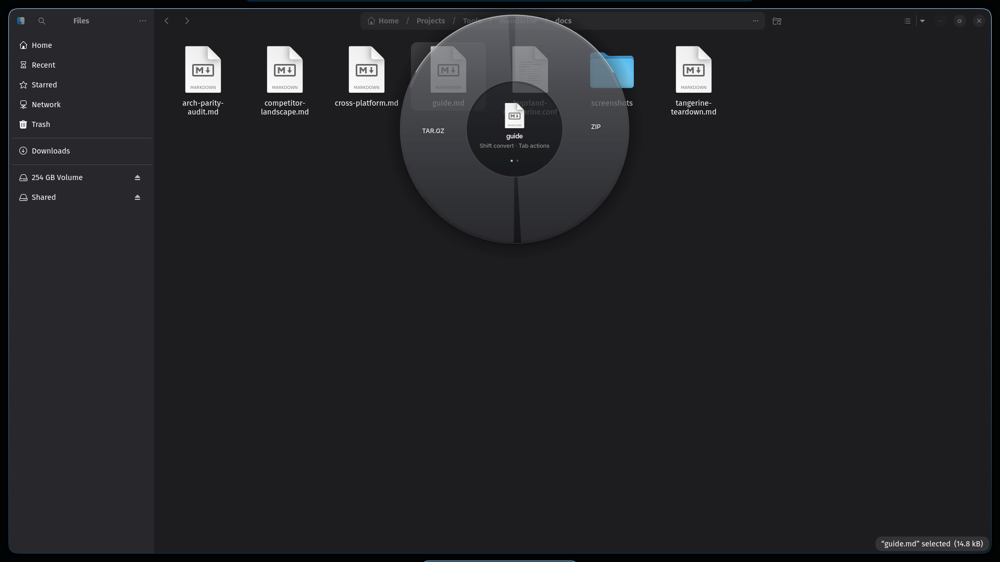

# Mandarine Tutorial

A hands-on guide from `cargo build` to dragging a file onto a glass wheel. Read the
[README](README.md) for the reference matrix and architecture; this file teaches the workflow.

## What Mandarine actually is

Mandarine is a local file converter with a radial menu. A hotkey opens a smoked-glass dial under
your cursor; you drop files onto a sector and the converted file appears next to the original.
No upload, no account, no network. Under the hood it builds command lines for tools you already
have (`ffmpeg`, ImageMagick, LibreOffice, poppler, zip/7z) and runs them locally.

Everything below assumes Linux + Hyprland. Windows specifics are in
[`docs/cross-platform.md`](docs/cross-platform.md).

---

## 1. Install

Install the Rust toolchain, GTK4, and the engines you intend to use:

```sh
sudo pacman -S --needed base-devel rust pkgconf gtk4 wl-clipboard
sudo pacman -S --needed ffmpeg imagemagick poppler libreoffice-fresh zip 7zip unrar
```

Engines are optional but **capability-gated**: the wheel only shows targets whose engine is
present. Install more later and they appear automatically on the next launch.

Build and install:

```sh
git clone <this repo> ~/Projects/mandarine
cd ~/Projects/mandarine
./install.sh
```

`install.sh` checks dependencies, builds a release binary, and installs it to
`~/.local/bin/mandarine`. Verify:

```sh
mandarine --version
```

---

## 2. Ask the machine what it can do

Before touching the GUI, run:

```sh
mandarine list
```

This probes your installed binaries (`magick -list format`, `ffmpeg -encoders`, etc.) and prints
the live conversion matrix. If `heic` or `avif` is missing from the image targets, your
ImageMagick build lacks that delegate — that is a system package issue, not a Mandarine bug.

This probe runs once per process and is cached. Every sector you see in the wheel comes from
this result.

---

## 3. Your first conversion (no GUI)

Start with a headless conversion to confirm the engine chain works:

```sh
cd /tmp
magick -size 64x64 xc:orange sample.png
mandarine convert sample.png --to webp
file sample.webp
```

Output lands beside the source as `sample.webp`. If a file with that name exists, Mandarine
writes `sample (2).webp` — **it never overwrites**.

Batch into a directory:

```sh
mkdir -p out
mandarine convert *.png --to jpg --out-dir out/
```

The general form is:

```sh
mandarine convert <files...> --to <target> [--out-dir <dir>]
```

Run `mandarine convert --help` for the full target list.

---

## 4. Open the wheel

There are four ways in. Pick the one that fits your setup.

### 4a. Hotkey (simplest)

Bind `mandarine` to a key. On ML4W dotfiles, binds live in a Lua file (the stock
`~/.config/hypr/custom.lua` is immutable):

```lua
-- ~/.config/ml4w/hypr/custom.lua
hl.bind("SUPER + Y", hl.dsp.exec_cmd("mandarine"))
```

Reload Hyprland, press `SUPER+Y`, and the dial appears under the cursor. Press it again to
close — there is only one instance.

### 4b. Mid-drag (no configuration)

Start dragging a file in your file manager. **Before releasing the mouse button**, tap
`SUPER+Y`. The dial opens under the pointer and hops it one pixel so Hyprland hands the
in-flight drag to the new surface. Release over a sector.

### 4c. Edge strip (no hotkey at all)

Wayland has no global "a drag started" event, so a client must already own a surface to be
offered a drag. `mandarine listen` keeps a 6 px drop target against a screen edge:

```sh
mandarine listen --edge top        # also bottom, left, right
```

Autostart it once per session:

```lua
exec-once = mandarine listen --edge top
```

Drag a file until it touches the strip; the dial opens under the cursor. Standby costs one
mapped surface (~33 MB PSS, zero CPU ticks at idle). Choose an edge your bars and docks do not
use — the strip takes pointer input across its 6 px.

### 4d. File manager script

When a drag cannot be handed to a new surface, start with the files already loaded:

```sh
# ~/.local/share/nautilus/scripts/Mandarine
#!/bin/sh
mandarine wheel --files "$@"
```

Make it executable and use it from the file manager's scripts menu.

---

## 5. Using the dial



*The dial with `guide.md` loaded. The centre shows the source name and the current page hint;
sectors show the targets available for what you dropped — here `TAR.GZ` and `ZIP`. The dot marks
the active page.*

The wheel has three pages. Hold a modifier to switch:

| Key | Page | What it does |
|---|---|---|
| none / **Shift** | Conversions | the format sectors |
| **Ctrl** | File actions | Copy, Copy Path, Terminal, Compress, Extract |
| **Alt** | Editing tools | Strip Meta, Rotate 90, Resize 50, Mute, Normalize |
| **Tab** | — | cycle pages |

Pick a sector with **1–9**, click, **←→** then **Enter**, or scroll. `Enter` only fires a lit
sector. **ESC** cancels.

A single file gets the conversions for its category. A mixed drop offers packing (ZIP / TAR.GZ).
If nothing is dropped within four seconds, Mandarine falls back to files on the clipboard
(`wl-paste text/uri-list`).

The centre previews the result name, for example `→ photo.webp`. The accent colour comes from
your wallpaper via matugen.

### Walkthrough: convert a screenshot

1. Take a screenshot to `~/Pictures/shot.png`.
2. Press `SUPER+Y`.
3. Drag `shot.png` onto the dial.
4. The image sectors light up. Press `3` for `webp` (or click it).
5. `~/Pictures/shot.webp` appears. The original is untouched.

### Walkthrough: pack mixed files

1. Select a `.png`, a `.pdf`, and a `.mp3` in your file manager.
2. Mid-drag them onto the dial with `SUPER+Y`.
3. The wheel detects mixed categories and offers ZIP / TAR.GZ.
4. Pick ZIP. A single archive is written beside the sources.

---

## 6. Headless recipes

The CLI uses the same engine builders as the wheel.

```sh
# images
mandarine convert photo.heic --to webp
mandarine convert scan.pdf --to png          # pdftoppm
mandarine convert *.jpg --to pdf --out-dir albums/

# audio and video
mandarine convert song.wav --to mp3
mandarine convert clip.mp4 --to gif
mandarine convert *.wav --to flac --out-dir flac/

# documents
mandarine convert report.docx --to pdf
mandarine convert data.xlsx --to csv

# PDF utilities
mandarine convert a.pdf b.pdf --to merge
mandarine convert booklet.pdf --to split

# editing tools
mandarine convert photo.png --to strip
mandarine convert photo.png --to rotate90
mandarine convert photo.png --to resize50
mandarine convert song.mp3 --to mute
mandarine convert song.mp3 --to normalize

# file actions
mandarine action copy-path photo.png
mandarine action copy photo.png
mandarine action compress photo.png
mandarine action extract archive.zip
```

---

## 7. Configure it

Create a writable config:

```sh
mandarine init-config        # never overwrites an existing file
```

Edit `~/.config/mandarine/config.toml`:

```toml
notify = true
audio_bitrate = "192k"
video_crf = 23
pdf_dpi = 300
clipboard_fallback_secs = 4
terminal = "auto"            # or "kitty", "wezterm", "foot", ...

[wheel]
size = 440
inner_radius = 0.42
sector_gap_deg = 3.0

[[custom_targets]]
id = "png90"
label = "PNG q90"
ext = "png"
categories = ["image"]
steps = ["magick", "{in}", "-quality", "90", "{out}"]
```

`custom_targets` entries appear as extra sectors for the listed categories. `{in}` and `{out}`
are substituted at run time.

---

## 8. Hyprland polish

Make the compositor blur the desktop behind the glass:

```lua
hl.window_rule({
    match = { class = "^(io.sahil.mandarine)$" },
    blur = true,
})
```

The dial is a layer-shell OVERLAY surface in the `mandarine` namespace. If your compositor does
not know that namespace, the material renders over raw desktop pixels and looks flat. Without
`wlr-layer-shell`, Mandarine falls back to a borderless toplevel that Hyprland floats and parks.

---

## 9. Troubleshooting

**A target I expect is missing.** Run `mandarine list`. The sector is gated on a probe — install
the engine and restart. ImageMagick's delegate list controls `heic`/`avif`.

**The drag never opens the wheel.** Wayland drag handoff is compositor-specific. Use the
file-manager script from section 4d, or record what the edge strip sees:

```sh
MANDARINE_DND_LOG=/tmp/dnd.log mandarine listen
```

If the log shows no drag event, the compositor never offered it the drag. If it shows an event
but no wheel, the failure is downstream.

**The wheel opens but looks flat.** Add the blur window rule from section 8 and confirm your
compositor supports the `mandarine` layer namespace.

**Conversion produces nothing.** Check `mandarine list`, then run the equivalent CLI command
from section 6 directly — wheel and CLI share the same argv builders, so a CLI failure isolates
the engine, not the UI.

**Conversions are slow or the wheel is heavy.** Prefer a release build (`./install.sh` builds one).
A debug `target/` directory can exceed 3 GB; `cargo clean` removes it without affecting the
installed binary.

---

## 10. Verify it yourself

```sh
cargo test          # argv builders, matrix, registry gating, naming, actions,
                    # clipboard parsing, wheel geometry, theme ramps
```

Then an end-to-end round trip:

```sh
cd /tmp && magick -size 64x64 xc:orange a.png
mandarine convert a.png --to webp && file a.webp
```

---

## Where next

- [`README.md`](README.md) — full target matrix, config reference, architecture
- [`docs/arch-parity-audit.md`](docs/arch-parity-audit.md) — current gap ledger
- [`docs/tangerine-teardown.md`](docs/tangerine-teardown.md) — what was reverse-engineered and
  what was deliberately not ported
- [`docs/competitor-landscape.md`](docs/competitor-landscape.md) — why the registry looks the way
  it does
